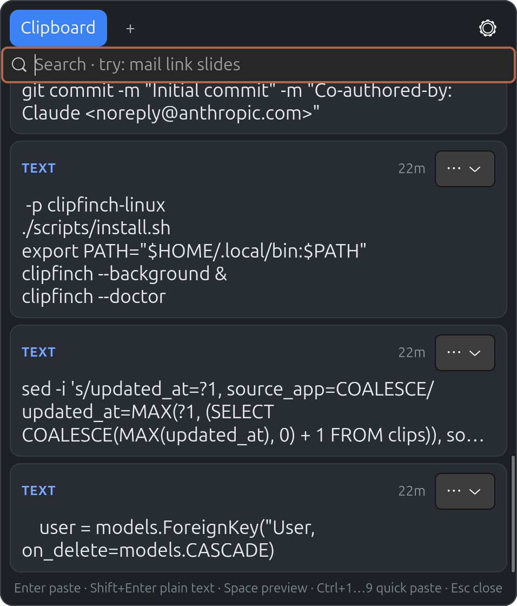

# Clipfinch

Clipboard history for Linux (GTK4, Rust). Written for Ubuntu/GNOME, inspired by
the macOS app Copywren. All code is original.



> **Status:** early alpha. Tested on Ubuntu 26.04 (Wayland session).

## Features

- Records text, links, images, files and colors, with **every clipboard format** kept
  so pasting restores the original (rich text, images, file copies).
- Smart search: `mail link slides` = kind `link` + the words `mail` and `slides`
  (matched against text, source app and title). Quote words to take them literally.
  Kinds: `text`, `link`, `image`, `file`, `color`.
- Pinboards (tabs) for clips you reuse. Drag a card onto a tab, or use the `⋯` menu.
  Pinned clips never expire.
- Paste as plain text, preview (Space), rename, open links/files, delete.
- Paste Queue: copy several things, paste them one by one.
- Password-manager copies (marked secret) are never stored. Per-app exclusion on X11.
- SQLite storage in `~/.local/share/clipfinch`, configurable retention.
- Tray icon, autostart, `.deb` packaging.

## Install (Ubuntu 24.04+)

```bash
./scripts/deps-ubuntu.sh        # build dependencies (+ cargo if missing)
./scripts/install.sh            # build, install to ~/.local, register shortcuts
clipfinch --background &        # or log out and in (autostart is enabled)
```

Default shortcuts (GNOME custom keybindings, editable in Settings):

| Shortcut | Action |
|---|---|
| Super+Shift+V | open / close the history popup |
| Super+Shift+C | start / stop the Paste Queue |
| Super+Shift+X | paste the next queued item |

Check what works on your machine: `clipfinch --doctor`.

## Popup keys

| Key | Action |
|---|---|
| Up / Down, PgUp / PgDn | move selection |
| Enter / Shift+Enter | paste / paste as plain text |
| Ctrl+1 … Ctrl+9 | paste the first nine cards |
| Space | preview (when the search box is empty) |
| Tab, Shift+Tab, Left / Right | switch tab |
| Ctrl+C | copy without pasting |
| Ctrl+O / Ctrl+R | open link or file / rename |
| Ctrl+Backspace | delete (or remove from pinboard) |
| Ctrl+N | new pinboard |
| Ctrl+, | settings |
| Esc | clear search, then close |

## Wayland: what works and what cannot

Wayland deliberately blocks several things a clipboard manager would like to do.
Clipfinch handles each as follows:

| Feature | X11 session | Wayland session (Ubuntu default) |
|---|---|---|
| Background clipboard capture | yes | yes, by running through XWayland (`GDK_BACKEND=x11,wayland`) |
| Global shortcut | GNOME keybinding | GNOME keybinding (`clipfinch --toggle`) |
| Popup position | near the mouse pointer | chosen by the compositor |
| Opens at the text cursor | not implemented | impossible for normal apps |
| Automatic Ctrl+V | XTest | `ydotool` (optional, see below) |
| Source app name / excluded apps | yes | no |

Without automatic paste, selecting a clip still puts it on the clipboard; you press
Ctrl+V yourself.

### Optional: automatic paste on Wayland with ydotool

```bash
sudo apt install ydotool
echo 'KERNEL=="uinput", GROUP="input", MODE="0660", OPTIONS+="static_node=uinput"' \
  | sudo tee /etc/udev/rules.d/80-uinput.rules
sudo usermod -aG input "$USER"      # log out and in afterwards
ydotoold &                          # start the daemon (add it to your autostart)
```

Set `CLIPFINCH_BACKEND=wayland` to run natively on Wayland instead of through
XWayland (background capture may then stop working while Clipfinch is not focused).

## Build and test

```bash
cargo build --release
cargo test -p clipfinch-core -p clipfinch-linux
cargo run -p clipfinch -- --background
cargo run -p clipfinch -- --toggle
cargo build --release --no-default-features    # without the tray icon
cargo install cargo-deb && cargo deb -p clipfinch
```

If `rustup` complains that Rust is already installed from apt, skip rustup: the apt
toolchain is fine (`sudo apt install cargo`).

## Layout

```
crates/core    data model, classification, search, SQLite store, settings, paste queue
crates/linux   session detection, X11 helpers, paste injection, GNOME shortcuts, autostart
crates/app     GTK4 app: clipboard monitor, popup, queue, settings, tray
assets/        desktop file and icon
scripts/       deps-ubuntu.sh, install.sh, uninstall.sh
```

## Differences from Copywren

- Paste Queue is driven by its own shortcut (`--queue-paste`) rather than by
  intercepting Ctrl+V, which Wayland does not allow.
- No "hide from screen sharing" option (no equivalent on Linux).
- The popup does not follow the text cursor (see the Wayland table).

## About this project

Clipfinch was written with the help of [Claude](https://claude.ai) (Anthropic).
It is inspired by [Copywren](https://github.com/sonatina-dream/copywren), a clipboard
manager for macOS, because I wanted something like it on Ubuntu. It shares no code
with Copywren and is not affiliated with it. Credit for the original idea goes to its author.

## License

MIT, see [LICENSE](LICENSE).
